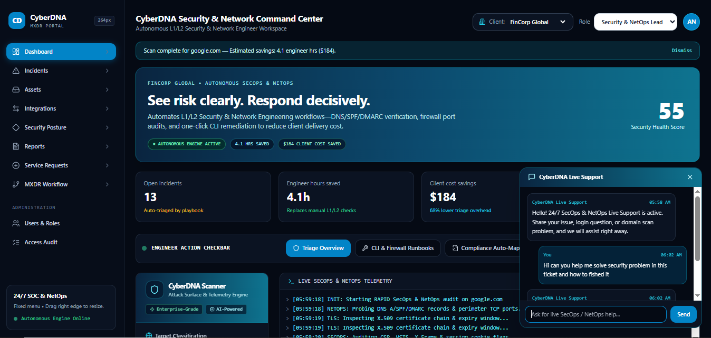

# CyberDNA MXDR & NetOps Portal

**Autonomous Managed Extended Detection & Response (MXDR) and Network Operations Command Center**

CyberDNA MXDR & NetOps Portal automates L1/L2 SecOps and NetOps workflows—combining real-time attack surface scanning, DNS/TLS and perimeter port auditing, AI executive briefs, copy-paste CLI runbooks, and live Jira, Slack, and ServiceNow ticketing.

## Key Capabilities & Benefits

- **Automated Security & Perimeter Reconnaissance:** Audits live HTTP headers (`CSP`, `HSTS`, `X-Frame-Options`, `NoSniff`, `Referrer-Policy`, `Permissions-Policy`), SSL/TLS certificates, DNS (`A`, `SPF`, `DMARC`), and exposed TCP ports.
- **AI Executive Briefs & CLI Runbooks:** Generates CVSS-scored risk summaries and ready-to-run Nginx, Apache, UFW firewall, and DNS TXT remediation commands.
- **Live ITSM & SOAR Ticketing:** Creates live tickets in **Jira**, sends alerts to **Slack**, escalates incidents to **ServiceNow**, and supports engineer-to-engineer ticket referral.
- **Measurable ROI & Client Savings:** Tracks engineering hours saved and client operational cost reductions in **USD ($)** with downloadable PDF reports.

## Quick Setup

1. **Backend:** Run `pip install flask flask-cors requests python-dotenv google-genai`, configure `.env`, and start `python scanner.py`.
2. **Frontend:** Run `npm install` and `npm run dev`, then open `http://localhost:5173`.
